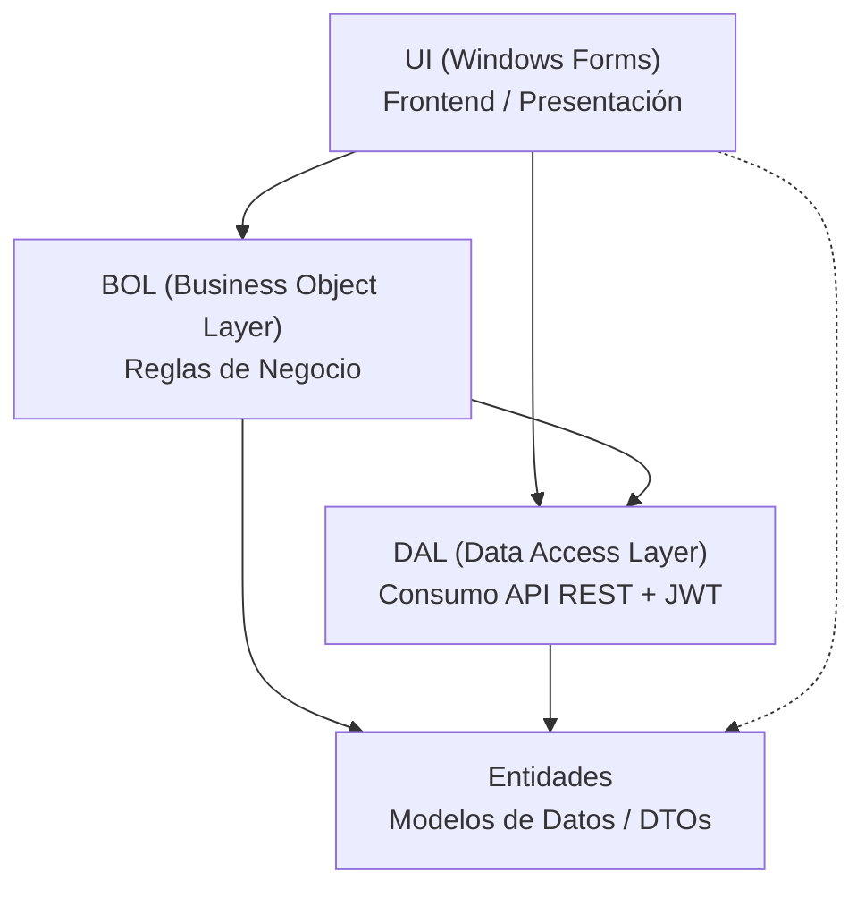

# Guía Paso a Paso: Proyecto N-Capas en C#

Documento de referencia para la creación, configuración y estructuración de la solución AppDemoClientes bajo una arquitectura N-Capas consumiendo un servicio web ASP.NET Core con autenticación JWT.

---

## Arquitectura del Sistema



---

## Lista de Pasos de Construcción

### 01. Creación de la Solución
1. Abrir Visual Studio.
2. Crear un nuevo proyecto seleccionando la plantilla **Solución en blanco** (*Blank Solution*).
3. Nombrar la solución como:
   ```text
   AppDemoClientes
   ```

---

### 02. Creación de los 4 Proyectos
Hacer clic derecho sobre la solución > **Agregar** > **Nuevo proyecto**:

| Proyecto | Tipo de Proyecto | Descripción |
| :--- | :--- | :--- |
| **BOL** | Biblioteca de clases (.NET) | Business Object Layer (Reglas y lógica de negocio). |
| **DAL** | Biblioteca de clases (.NET) | Data Access Layer (Acceso a datos y consumo HTTP). |
| **Entidades** | Biblioteca de clases (.NET) | Modelos que representan la estructura lógica de los datos. |
| **UI** | Aplicación de Windows Forms | Interfaz gráfica de usuario (Frontend de escritorio). |

---

### 03. Limpieza Inicial de Archivos
- Eliminar el archivo predeterminado `Class1.cs` en los proyectos:
  - `BOL`
  - `DAL`
  - `Entidades`
- En el proyecto `UI`, eliminar el formulario inicial `Form1.cs`.

> [!NOTE]
> El objetivo es implementar un CRUD de Clientes a través de un servicio web ASP.NET con autenticación mediante Token JWT (Login).

---

### 04. Estructura de Clases y Responsabilidades

```text
AppDemoClientes/
├── BOL/
│   ├── ClienteBol.cs              # Consume DAL y sirve los datos a la UI
│   └── ReglaNegocioException.cs   # Excepción personalizada para reglas de negocio
├── DAL/
│   ├── IClienteDal.cs             # Interfaz que define los contratos y métodos abstractos
│   ├── ClienteDal.cs              # Contiene la lógica para consumir la API REST
│   └── ApiException.cs            # Excepción personalizada para errores del servicio API
├── Entidades/
│   └── Cliente.cs                 # Representa la estructura de la tabla (get; set;)
└── UI/
    ├── FrmCliente.cs              # Formulario visual / Frontend
    └── Program.cs                 # Punto de entrada de la aplicación
```

---

### 05. Configuración del Punto de Entrada
En el proyecto `UI`, abrir `Program.cs` y configurar la inicialización para ejecutar el formulario principal:

```csharp
Application.Run(new FrmCliente());
```

---

### 06. Definir Proyecto de Inicio
1. En el Explorador de Soluciones, hacer clic derecho sobre el proyecto **UI**.
2. Seleccionar la opción **Establecer como proyecto de inicio** (*Set as Startup Project*).

---

### 07. Orden de Tabulación en la Interfaz (UI)
1. Abrir la vista de diseño de `FrmCliente.cs`.
2. Ir al menú superior: **Ver** > **Orden de tabulación**.
3. Hacer clic sobre los componentes en el orden secuencial deseado para la navegación con la tecla Tab.

---

### 08. Capa Entidades: Cliente.cs
Definir la clase `Cliente` con las propiedades (`get; set;`) que representen los campos del modelo.

---

### 09. Contrato de Datos: IClienteDal.cs
1. Agregar en el proyecto **DAL** una referencia al proyecto **Entidades**.
2. Definir la interfaz con los métodos abstractos que deberá implementar la capa de datos:

```csharp
namespace DAL
{
    public interface IClienteDal
    {
        // Métodos y firmas del contrato CRUD
    }
}
```

---

### 10. Implementación de Acceso a Datos: ClienteDal.cs
Heredar e implementar el contrato de la interfaz:

```csharp
namespace DAL
{
    public class ClienteDal : IClienteDal
    {
        // Lógica de consumo de la API REST
    }
}
```

---

### 11. Clases de Excepciones
- **DAL / ApiException.cs**: Mecanismo de validación y control de errores HTTP o fallas en el consumo de la API.
- **BOL / ReglaNegocioException.cs**: Mecanismo de validación de reglas de negocio antes de la persistencia o consulta.

---

### 12. Capa de Negocio: ClienteBol.cs
Implementar los métodos de negocio aprovechando la capa DAL y preparando los datos para ser presentados en la UI.

---

### 13. Referencias del Proyecto BOL
Agregar las siguientes referencias dentro del proyecto **BOL**:
- Referencia a **Entidades**
- Referencia a **DAL**

---

### 14. Referencias en la Capa UI
1. Agregar en el proyecto **UI** las referencias a:
   - **BOL**
   - **DAL**
   - **Entidades**
2. Importar los espacios de nombres necesarios:

```csharp
using BOL;
using DAL;
using Entidades;
```

---

### 15. Personalización del DataGridView
Configurar las siguientes propiedades en el control de grilla de clientes:

| Propiedad | Valor | Descripción |
| :--- | :--- | :--- |
| `AllowUserToAddRows` | `False` | Desactiva la fila vacía para agregar registros directamente. |
| `AllowUserToDeleteRows` | `False` | Evita eliminar filas directamente con la tecla Supr. |
| `AllowUserToOrderColumns` | `True` | Permite al usuario reordenar las columnas. |
| `AllowUserToResizeColumns` | `False` | Bloquea el ajuste manual del ancho de columnas. |
| `AllowUserToResizeRows` | `False` | Bloquea el ajuste manual del alto de filas. |
| `MultiSelect` | `False` | Permite seleccionar únicamente una fila a la vez. |
| `ReadOnly` | `True` | Establece la grilla en modo solo lectura. |
| `SelectionMode` | `FullRowSelect` | Selecciona la fila completa al hacer clic en cualquier celda. |
| `BackgroundColor` | *(A elección)* | Color de fondo del control. |
